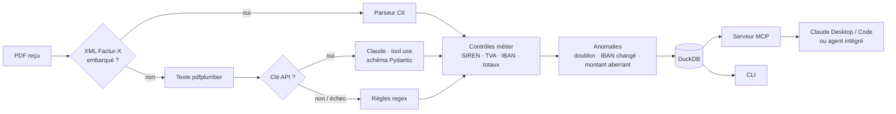

# FactuAgent — agent IA de traitement des factures fournisseurs

> Lit les factures PDF (Factur-X ou PDF classiques), extrait les données, contrôle leur cohérence,
> repère les fraudes et les doublons, et met le tout à disposition d'un agent IA via un serveur **MCP**.

*EN — FactuAgent is an AI agent for French supplier invoices: Factur-X/CII parsing, LLM-based extraction
for unstructured PDFs, business-rule validation (SIREN, VAT, IBAN, totals), fraud and duplicate detection,
a DuckDB analytics store, and an MCP server so any AI assistant can query invoices in natural language.*

---

## Pourquoi ce projet

Depuis le **1er septembre 2026**, toutes les entreprises françaises doivent pouvoir **recevoir** des factures
électroniques ; les grandes entreprises et ETI doivent aussi en **émettre**, les PME et TPE suivront au
1er septembre 2027. Pendant la transition, les services comptables reçoivent un mélange de Factur-X et de
PDF « à l'ancienne ». En parallèle, la **fraude au changement de RIB** (un faux courrier qui « met à jour »
l'IBAN d'un fournisseur) reste un risque majeur pour les PME.

FactuAgent traite les deux flux dans un même pipeline et ne laisse passer en paiement que ce qui est cohérent.

## Ce que ça fait

| Étape | Détail |
|---|---|
| **1. Lecture Factur-X** | Si le PDF embarque un XML CII (EN 16931), il est lu directement : 100 % fiable, zéro coût d'IA |
| **2. Extraction IA** | Sinon, Claude extrait les champs via *tool use* avec un schéma JSON strict (Pydantic) |
| **3. Repli par règles** | Sans clé d'API, ou si l'IA échoue, des règles (regex) prennent le relais sur les mises en page connues |
| **4. Contrôles métier** | Clé de Luhn du SIREN, clé du n° de TVA intracommunautaire, IBAN (mod 97), HT + TVA = TTC, somme des lignes, délai de paiement légal (60 jours) |
| **5. Détection d'anomalies** | Doublons, **changement d'IBAN fournisseur**, montant aberrant par rapport à l'historique |
| **6. Stockage analytique** | DuckDB : `invoices`, `invoice_lines`, `issues` |
| **7. Agent & MCP** | Serveur MCP (7 outils) utilisable depuis Claude Desktop / Claude Code, plus un agent intégré en Python |



## Résultats

Évaluation sur 41 factures de démonstration générées (3 mises en page, 10 Factur-X, 7 anomalies injectées),
**en mode sans LLM** :

| Indicateur | Résultat |
|---|---|
| Précision par champ — Factur-X | **100 %** |
| Précision par champ — mises en page tableau connues (règles) | **100 %** |
| Précision par champ — factures rédigées en texte libre (règles) | **0 %** → envoyées en revue humaine |
| Anomalies injectées détectées (rappel) | **7 / 7** |
| Fausses alertes | 1 (montant aberrant, en simple avertissement) |

Lecture honnête de ces chiffres : les règles sont écrites pour les mises en page connues, leur 100 % ne dit
rien des factures réelles. Les factures rédigées en texte libre montrent leur limite, c'est exactement le
cas que l'extraction par LLM couvre (`python eval/evaluate.py --llm`). Rien n'est jamais validé à
l'aveugle : ce qui n'est pas extrait part en revue.

Rapport détaillé : [`eval/report.md`](eval/report.md).

## Démarrage rapide

```bash
pip install -r requirements.txt

# 1. Générer le jeu de démo (41 PDF + vérité terrain)
python scripts/generate_invoices.py --out data/invoices

# 2. Traiter la boîte de réception
python -m factuagent.cli process data/invoices
# ✗ 034_classic.pdf  [rules  ] IBAN_CHANGED
# ✗ 041_doublon_021_classic_facturx.pdf  [facturx] DUPLICATE
# 41 factures : 31 OK, 2 à vérifier, 8 à revoir

# 3. File de contrôle et synthèse fournisseurs
python -m factuagent.cli review
python -m factuagent.cli suppliers
python -m factuagent.cli sql "SELECT seller_name, sum(total_ttc) FROM invoices GROUP BY 1"

# 4. Évaluation
python eval/evaluate.py            # règles + Factur-X
python eval/evaluate.py --llm      # avec Claude (ANTHROPIC_API_KEY requis)

# 5. Tests
pytest -q
```

### Activer l'extraction par IA

```bash
export ANTHROPIC_API_KEY=...
export FACTUAGENT_MODEL=claude-haiku-5-5      # modèle d'extraction (rapide, peu coûteux)
```

### Brancher le serveur MCP sur Claude Desktop

Dans la configuration MCP de Claude Desktop :

```json
{
  "mcpServers": {
    "factuagent": {
      "command": "python",
      "args": ["-m", "factuagent.mcp_server"],
      "cwd": "/chemin/vers/factuagent",
      "env": { "FACTUAGENT_DB": "data/factuagent.duckdb", "FACTUAGENT_INBOX": "data/invoices" }
    }
  }
}
```

Puis, dans la conversation : *« Quelles factures dois-je bloquer avant le paiement de vendredi ? »*,
*« Combien avons-nous dépensé chez Nordica Cloud ce trimestre ? »*.

### Agent intégré (sans client MCP)

```bash
python -m factuagent.agent "Quels fournisseurs ont changé d'IBAN et pour quels montants ?"
```

## Outils exposés à l'agent

| Outil | Rôle |
|---|---|
| `list_inbox` | Liste les PDF en attente |
| `process_invoice` | Traite un PDF : extraction, contrôles, anomalies |
| `list_invoices` | Filtre par statut ou fournisseur |
| `get_invoice` | En-tête, lignes et anomalies d'une facture |
| `review_queue` | Factures à contrôler, les plus graves d'abord |
| `supplier_summary` | Volumes, montants, IBAN distincts par fournisseur |
| `query_sql` | SQL DuckDB **en lecture seule** pour l'analyse ad hoc |

**Garde-fous.** L'agent ne peut ni modifier ni supprimer de données : SQL limité à `SELECT`/`WITH`, sans
accès fichiers ni extensions, et lecture de PDF cantonnée à la boîte de réception (pas de traversée de
chemin). Les deux protections sont couvertes par les tests. L'agent signale, il ne valide jamais un paiement.

## Structure

```
factuagent/
├── models.py       # schéma Pydantic (inspiré EN 16931)
├── facturx.py      # écriture / lecture XML CII, pièce jointe PDF
├── extractors.py   # extraction par règles et par LLM (tool use)
├── validators.py   # SIREN, TVA intracom, IBAN, cohérence des montants
├── pipeline.py     # orchestration + détection d'anomalies
├── store.py        # DuckDB
├── tools.py        # outils métier partagés (MCP + agent)
├── mcp_server.py   # serveur MCP (stdio)
├── agent.py        # boucle agentique avec Claude
└── cli.py
scripts/generate_invoices.py   # jeu de démo synthétique avec anomalies
eval/evaluate.py               # précision par champ, rappel / précision des anomalies
tests/                         # 21 tests (pytest)
```

## Limites et pistes

- **Factur-X** : le XML CII est embarqué comme pièce jointe, sans la conformité PDF/A-3 complète
  (métadonnées XMP). Pour de la production, s'appuyer sur une bibliothèque certifiée et une
  **plateforme agréée (PA)**.
- **PDF scannés** : non gérés pour l'instant ; piste : OCR ou modèle vision avant l'extraction.
- **Données de démo synthétiques** : SIREN et IBAN générés avec des clés valides mais fictifs.
- Pistes : rapprochement automatique avec les bons de commande, export vers l'ERP, tableau de bord.

## Stack

Python 3.11+ · Pydantic · pdfplumber · pypdf · lxml · DuckDB · Anthropic SDK (Claude, tool use) ·
MCP Python SDK · pytest · reportlab (jeu de démo)

---

**Auteur :** Fayçal Boubekri — AI & Data Engineer, Paris. Missions au forfait : agents IA, RAG, pipelines de données.
